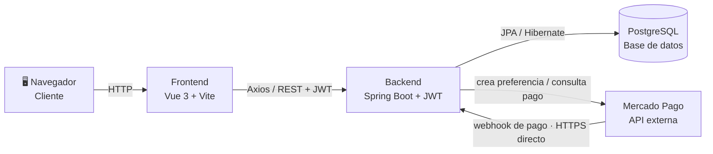

# Diagrama de Arquitectura — Componentes

*El backend expone la API REST que consume el frontend; se comunica con Mercado Pago para crear pagos y recibe sus notificaciones por webhook, directo sobre HTTPS gracias al dominio público de Render (sin túneles).*
