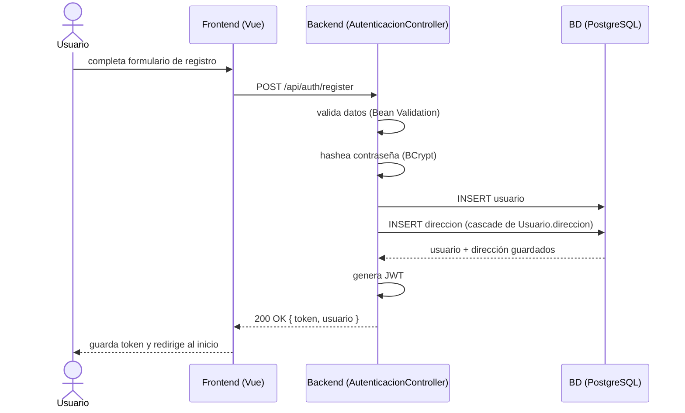

# Diagrama de Secuencia — Registro de Usuario

*El usuario queda autenticado inmediatamente después de registrarse, sin pasar por login. La dirección del formulario se guarda sola junto con el usuario, por el `cascade = ALL` de `Usuario.direccion`.*
