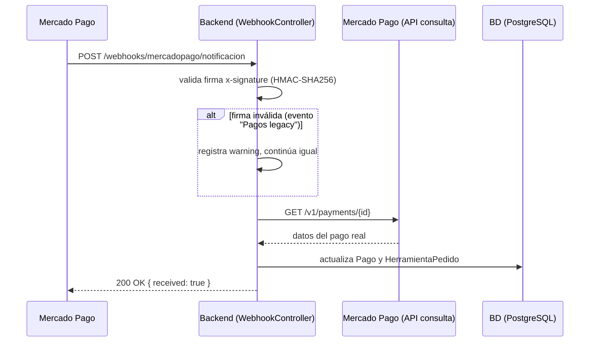

# Diagrama de Secuencia — Webhook de Mercado Pago

*Aunque falle la firma (caso conocido de eventos legacy) nunca se confía ciegamente: siempre se reconsulta el pago contra la API de Mercado Pago antes de actualizar la base.*
