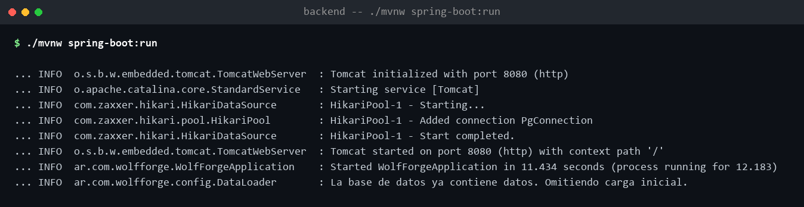
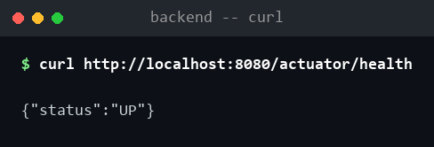
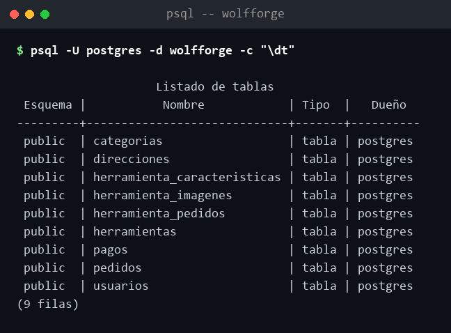
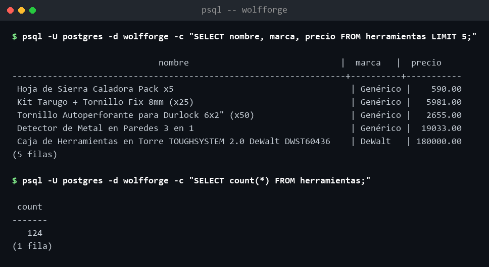

🔨 **E-commerce de herramientas, desarrollado por Escuadrón Lobo.**

**Visitanos:** [wolfforge-frontend.onrender.com](https://wolfforge-frontend.onrender.com) ✨


## 🔹 Descripción

**WolfForge** es una tienda online de herramientas y equipamiento para el hogar, el taller y la obra. Catálogo con búsqueda y filtros por categoría y marca, carrito de compras, pagos reales con Mercado Pago, panel de administración y seguimiento completo del ciclo de vida de cada pedido.

Proyecto integrador de **Programación IV** — UTN FRSR.

---

## 🛒 Características

- 🔐 Autenticación y autorización con JWT y Spring Security
- 🔧 Gestión de herramientas (CRUD completo) con categorías y marcas
- 🔍 Búsqueda, filtros y orden en el catálogo
- 🏷️ Ofertas del día con descuentos
- 🛍️ Carrito de compras nativo
- 💳 Integración real con **Mercado Pago** (pago, webhook, confirmación automática)
- 📦 Ciclo de vida completo del pedido: confirmación de recepción, devolución y cancelación
- 👥 Roles de usuario (`ADMINISTRADOR` / `USUARIO`)
- 📊 Panel de administración para herramientas y pedidos
- 📱 Diseño responsive (desktop y mobile)

---

## 🖥️ Tecnologías

<div style="display: flex; gap: 15px; align-items: center; flex-wrap: wrap;">
  
  
  
  
  
  
  
  
</div>

### Backend
- **Java 21**
- **Spring Boot 3.5.7**
- **Spring Security** (JWT)
- **Spring Data JPA** (Hibernate)
- **PostgreSQL**
- **Maven** (wrapper `mvnw` incluido, no hace falta tener Maven instalado aparte)
- **SDK de Mercado Pago**
- **Docker** (build de producción)

### Frontend
- **Vue 3** (`<script setup>`)
- **Vue Router** · **Pinia** · **Axios** · **Vite**

### Infraestructura
- **Render** (backend como Web Service con Docker, frontend como Static Site, base de datos PostgreSQL administrada)

---

## 🌐 Demo en vivo

El proyecto está desplegado en Render:

- **Sitio:** https://wolfforge-frontend.onrender.com
- **API:** https://wolfforge-backend.onrender.com ( Swagger en `/swagger-ui.html`)

> ⚠️ El plan gratuito de Render "duerme" el backend después de un rato de inactividad. Si la primera request tarda 30-50 segundos en responder, es normal — se está despertando, no está colgado.

---

## 💻 Cómo correrlo en tu máquina (desarrollo)

Para desarrollar necesitás el backend y el frontend corriendo localmente. **No hace falta Docker ni ngrok**: el backend corre directo con el wrapper de Maven, y como ya vive en Render con HTTPS real, los pagos de punta a punta se prueban contra la demo en vivo (ver paso 5), no hace falta un túnel propio por persona.

### 📋 Requisitos previos

- **Java 21+**
- **Node.js 18+** y npm
- **PostgreSQL 14+** corriendo en tu máquina

### 1. Clonar y crear la base de datos

```bash
git clone https://github.com/HotCode2025/EscuadronLobo-CuartoSemestre-ProyectoIntegrador.git
cd EscuadronLobo-CuartoSemestre-ProyectoIntegrador
psql -U postgres -c "CREATE DATABASE wolfforge;"
```

(o abrí pgAdmin y creá una base llamada `wolfforge` a mano)

### 2. Configurar `application.properties`

Ese archivo tiene datos sensibles (contraseña de tu Postgres, token de Mercado Pago) así que **no está en el repo** — cada uno arma el suyo a partir de la plantilla:

```bash
cd backend/src/main/resources
cp application.properties.example application.properties
```

Editá `application.properties` y completá estas variables:

```properties
# Base de datos (dejá "postgres" si no cambiaste nada al crear la base)
spring.datasource.username=postgres
spring.datasource.password=TU_PASSWORD_LOCAL

# Clave para firmar JWT (podés dejar la de la plantilla, no hace falta cambiarla)
jwt.secret=TU_CLAVE_SECRETA_DE_32_CARACTERES_MINIMO

# Mercado Pago (solo necesario si vas a correr el backend local Y probar pagos
# sin usar la demo de Render — ver paso 5). Se consigue en:
# https://www.mercadopago.com.ar/developers/panel/app -> Credenciales de prueba
mercadopago.access-token=TU_ACCESS_TOKEN_DE_PRUEBA
mercadopago.webhook.secret=TU_WEBHOOK_SECRET
```

El resto de los valores (JWT, Mercado Pago) podés dejarlos como están en la plantilla — no los necesitás para desarrollar funcionalidades que no sean de pagos.

### 3. Levantar el backend

```bash
cd backend
./mvnw spring-boot:run
```

Queda en `http://localhost:8080`. La primera vez que arranca, con la base vacía, carga solo categorías, marcas y el catálogo de herramientas — no hay usuarios de ejemplo más que el admin.

**Verificar que arrancó bien** — la consola debería terminar así, sin errores:



Y el health check debería responder `UP`:

```bash
curl http://localhost:8080/actuator/health
```



Chequeá también que las tablas se crearon:

```bash
psql -U postgres -d wolfforge -c "\dt"
```



Van a ser 9: las 7 entidades (`usuarios`, `herramientas`, `categorias`, `direcciones`, `pedidos`, `herramienta_pedidos`, `pagos`) más `herramienta_caracteristicas` y `herramienta_imagenes`, que Hibernate crea aparte por las listas `@ElementCollection` de `Herramienta`.

Y que el catálogo se haya cargado:

```bash
psql -U postgres -d wolfforge -c "SELECT nombre, marca, precio FROM herramientas LIMIT 5;"
```



**Cuenta de administrador** (se crea sola en el primer arranque, con la base vacía):

| Campo | Valor |
|---|---|
| Email | `admin@wolfforge.com` |
| Contraseña | `admin1234` |

Con esa cuenta ya podés entrar al panel de administración. Para probar como usuario común, registrate normalmente desde el frontend.

### 4. Levantar el frontend

```bash
cd frontend
npm install
npm run dev
```

Queda en `http://localhost:3000`. Con esto ya podés navegar el catálogo, registrarte, loguearte, armar el carrito y usar el panel de admin.

### 5. (Opcional) Probar el flujo de pago completo

Como el backend local no tiene HTTPS, Mercado Pago no puede redirigir de vuelta a `localhost` después de pagar. Para probar un pago de punta a punta sin montar ningún túnel, apuntá tu frontend local a la API ya desplegada en Render en vez de a tu backend local:

```bash
# frontend/.env.local
VITE_API_URL=https://wolfforge-backend.onrender.com
```

Reiniciá `npm run dev` y listo: tu frontend local habla con el backend real de Render, que ya tiene todo configurado para redirigir y recibir el webhook correctamente.

Para pagar, usá una tarjeta de prueba de Mercado Pago (por ejemplo Mastercard `5031 7557 3453 0604`, CVV `123`, vencimiento `11/30`) con el titular `APRO` para que el pago se apruebe automáticamente. Las cuentas de comprador/vendedor de prueba del equipo se comparten por canal interno, no acá.

---

## 🔧 Solución de problemas

**Error: "No se puede conectar a la base de datos"**
- Verificá que PostgreSQL esté corriendo y que la base `wolfforge` exista.
- Revisá usuario/contraseña en `application.properties`.

**Error 401/403 al usar el panel de administración**
- Iniciá sesión con una cuenta que tenga rol `ADMINISTRADOR` (el usuario admin se carga solo la primera vez que arranca el backend con la base vacía — ver paso 3).

**No me redirige bien después de pagar / el webhook no llega**
- Si estás corriendo el backend local, revisá el paso 5 de instalación (apuntá tu frontend a la API de Render para probar pagos sin túnel propio).

**"Algo salió mal..." al pagar, diciendo que una de las partes es de prueba**
- Pasa si intentás pagar como invitado contra el vendedor de prueba en algunos casos. Iniciá sesión primero con una cuenta de comprador de prueba y reintentá.

**La demo de Render tarda en responder**
- Es el plan gratuito "despertando" tras inactividad (30-50 segundos la primera vez). No es un error.

---

## 🗂️ Estructura del proyecto

```
EscuadronLobo-CuartoSemestre-ProyectoIntegrador/
├── backend/
│   ├── src/main/java/ar/com/wolfforge/
│   │   ├── config/          # Configuraciones (CORS, carga de datos inicial)
│   │   ├── controller/      # Controladores REST
│   │   ├── dto/             # Data Transfer Objects (request/response)
│   │   ├── entity/          # Entidades JPA (Usuario, Herramienta, Pedido, Pago, etc.)
│   │   ├── enums/           # Enums (UsuarioRol, EstadoPedido, EstadoPago)
│   │   ├── exceptions/      # Manejo centralizado de errores
│   │   ├── mapper/          # Conversión entidad ↔ DTO
│   │   ├── repository/      # Repositorios JPA
│   │   ├── security/        # JWT, filtros de seguridad
│   │   └── service/         # Lógica de negocio (interfaces e implementaciones)
│   ├── Dockerfile           # Build de producción, usado por el deploy en Render
│   └── pom.xml
├── frontend/
│   ├── src/
│   │   ├── components/      # Componentes reutilizables (Navbar, Footer, etc.)
│   │   ├── composables/     # Lógica reutilizable (composables de Vue)
│   │   ├── views/           # Vistas/páginas
│   │   ├── router/          # Configuración de rutas
│   │   ├── stores/          # Stores de Pinia (auth, carrito, etc.)
│   │   ├── services/        # Cliente Axios
│   │   └── utils/           # Utilidades varias
│   ├── public/
│   └── package.json
├── Documentacion/             # Brief, manuales, diagramas e imágenes del README
├── render.yaml                # Blueprint de deploy (backend + frontend + base de datos)
└── README.md
```

---

## 🚀 Despliegue en Render

El blueprint (`render.yaml`) define 3 servicios conectados entre sí:

- **`wolfforge-db`** — PostgreSQL administrado (plan free).
- **`wolfforge-backend`** — Web Service con Docker (usa `backend/Dockerfile`), health check en `/actuator/health`.
- **`wolfforge-frontend`** — Static Site (build de Vite), con regla de rewrite para que Vue Router funcione al refrescar cualquier ruta.

Las credenciales de base de datos y el JWT secret se generan automáticamente. Las credenciales de Mercado Pago (`MERCADOPAGO_ACCESS_TOKEN`, `MERCADOPAGO_WEBHOOK_SECRET`) se cargan a mano en el panel de Render — nunca quedan en el repo.

---

## 🔒 Seguridad

- Autenticación basada en **JWT**
- Roles de usuario: `ADMINISTRADOR` y `USUARIO`
- Validación de firma HMAC-SHA256 en los webhooks de Mercado Pago (header `x-signature`)
- `application.properties` está en `.gitignore`: nunca se sube con credenciales reales. El repo solo versiona `application.properties.example`, con placeholders.

⚠️ **Importante:** este proyecto usa exclusivamente credenciales de **prueba (sandbox)** de Mercado Pago — nunca credenciales de producción.

---

##### **Equipo Escuadrón Lobo**

Proyecto integrador de Programación IV — UTN FRSR.
